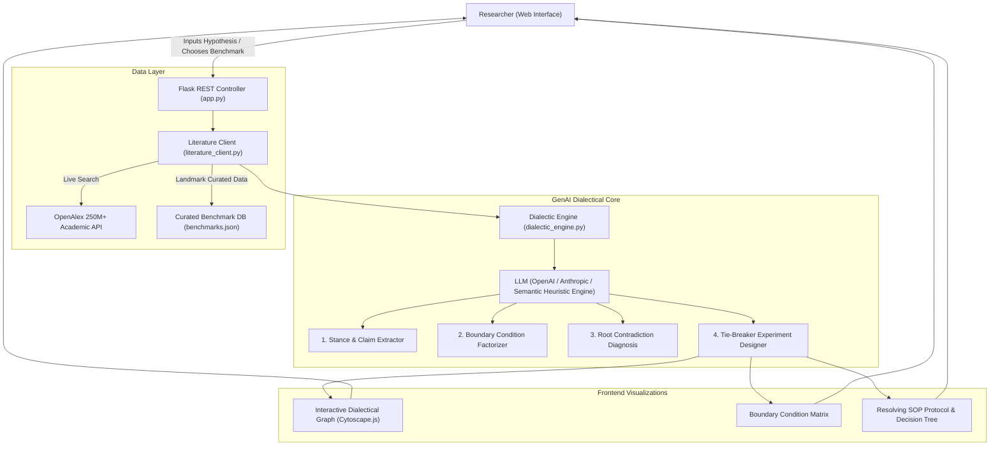

# Contradictome (🔬⚔️)
### *The Dialectical AI Research Assistant & Tie-Breaker Experiment Designer*

[](https://python.org)
[](https://flask.palletsprojects.com/)
[](https://cytoscape.org/)
[](LICENSE)

> **Contradictome** is a generative AI research scientist assistant built to solve science's biggest blind spot: **confirmation bias and unmapped boundary conditions**.
> Instead of passively summarizing papers or answering single-PDF questions, Contradictome actively searches for **contradictory evidence**, pinpoints the **mechanistic root causes of discrepancy**, and **synthesizes publication-grade resolving ("tie-breaker") experiments**.

---

## 🎯 The Problem with Existing AI Research Assistants

Most existing tools (e.g. ChatPDF, Elicit, SciSpace) act as passive query responders:
1. **Confirmation Bias:** If a researcher asks *"Does Metformin extend lifespan?"*, standard search engines return 20 papers confirming the hypothesis, ignoring critical null or conflicting replications.
2. **Unmapped Boundary Conditions:** Studies in *C. elegans* or inbred mice often contradict clinical human trials or outbred cohorts because parameters (dose, diet, baseline glycemic state, post-mortem intervals) diverge silently.
3. **No Resolution Engine:** Knowing two papers disagree is useless unless someone designs the **critical experiment** that settles the debate.

**Contradictome** introduces the **Dialectical Method** to AI science:
$$\text{Thesis (Pro Claims)} \iff \text{Antithesis (Con / Null Replications)} \Longrightarrow \text{Synthesis (Tie-Breaker Experiment)}$$

---

## 🌟 Key Capabilities

### 1. Dual-Stance Literature Harvester
- Queries academic catalogs (OpenAlex API) with paired queries:
  - **Affirmative Stance:** Direct mechanistic search
  - **Adversarial Stance:** Actively queries for *"failure to replicate"*, *"null effect"*, *"contradicts"*, and *"dispute"*
- Reconstructs abstracts and bibliometrics in real-time.

### 2. GenAI Dialectical Analysis Engine
- **Stance Classification:** Categorizes literature into `PRO` (Corroborating), `CON` (Refuting/Null), and `BOUNDARY` (Context-dependent).
- **Consensus Health Score:** Computes a quantitative controversy index (0-100%) indicating scientific friction.
- **Root Contradiction Diagnosis:** Explains *why* the literature is divided (e.g., metabolic state, fixation delay, benchmark contamination).

### 3. Interactive Dialectical Evidence Graph
- Built with **Cytoscape.js** with animated concentric physics layout:
  - **Cyan Node:** Central Research Hypothesis
  - **Emerald Nodes:** Corroborating Studies
  - **Crimson Nodes:** Contradicting / Null Replications
  - **Amber Nodes:** Conditional / Boundary Studies
  - **Dashed Red Edges:** Direct contradiction clashes between opposing studies
- **Study Deep-Dive Drawer:** Click any node to inspect extracted claims, experimental models, dosages, and identified confounders with direct DOI links.

### 4. Orthogonal Boundary Factor Matrix
- A structured comparative matrix lining up opposing papers side-by-side:
  - *Model System* (e.g. In vitro vs. In vivo murine vs. Human cohort)
  - *Intervention / Setup* (Titrated dose vs. fixed chow vs. prompt perturbation)
  - *Readout / Assay* (Survival curves vs. Western blot vs. stereology)
  - *Identified Confounder* (Single-sex cohort, bacterial folate mediation, epitope loss)

### 5. Resolving Tie-Breaker Protocol Synthesizer
- Generates publication-ready experimental protocols:
  - **Scientific Rationale & Design Type** (e.g., $2 \times 2$ Factorial Invariance Study)
  - **Independent & Dependent Variables**
  - **Positive & Negative Controls**
  - **Step-by-Step SOP Protocol**
  - **Decisive Outcomes Decision Tree:**
    - *Branch A:* If [Metric $> X$] $\rightarrow$ Confirms Thesis (Camp 1)
    - *Branch B:* If [Metric $\le X$] $\rightarrow$ Confirms Antithesis (Camp 2)
  - **Estimated Budget, Timeline, and Statistical Power Calculations**

### 6. One-Click Manuscript & Report Export
- Export findings into formatted **Markdown (`.md`)** or **LaTeX (`.tex`)** ready for Overleaf or preprint submissions.

---

## 🏗️ System Architecture



---

## ⚡ Quick Start

### 1. Launch the Server
In this directory, simply run:
```bash
./run.sh
```
Or directly with Python:
```bash
python3 app.py
```

### 2. Open the Web Interface
Open your web browser and navigate to:
```
http://localhost:5050
```

### 3. Explore Pre-Loaded Scientific Controversies
Click the **"⚡ Load a Landmark Scientific Controversy"** dropdown at the top right to instantly explore:
1. **Metformin & Mammalian Longevity:** Invertebrate folate modulation vs. NIA ITP mouse null results vs. human pre-diabetic cohorts.
2. **Chain-of-Thought (CoT) Prompting:** Emergent reasoning claims vs. token-budget computation and Apple's GSM-Symbolic failure modes.
3. **Adult Human Neurogenesis:** Dentate gyrus progenitor persistence vs. Sorrells et al. Nature post-mortem epitope degradation.

### 4. Audit Your Own Hypothesis
Type any research claim into the hero input bar and click **"Audit Controversy"**:
- *e.g., "Targeting KRAS G12D with small molecule inhibitors overcomes resistance in pancreatic ductal adenocarcinoma"*
- *e.g., "Ketogenic diet improves cognitive performance in Alzheimer's disease models"*

---

## ⚙️ Configuration & API Keys

Contradictome works **100% out of the box** in self-contained mode without needing any external API keys (using its built-in semantic heuristic reasoning engine and curated benchmarks).

### Supported Providers:
- **xAI Grok** (Recommended): `grok-2-latest`, `grok-beta`
- **OpenAI**: `gpt-4o`, `gpt-4o-mini`, `o1`
- **Anthropic**: `claude-3-5-sonnet`

### Configuring Keys via the Web UI:
1. Click the **"Settings"** button in the top navigation bar of the web interface.
2. Enter your **xAI / Grok API Key** (e.g. `xai-...`), or optionally **OpenAI** / **Anthropic** keys.
3. Select your desired active model from the dropdown.
4. Click **Save Settings**. Active status badges will turn green immediately.

### Configuring Keys via Environment Variables:
```bash
# xAI / Grok key
export XAI_API_KEY="xai-your-key-here"
# or
export GROK_API_KEY="xai-your-key-here"

# (Optional) OpenAI or Anthropic keys
export OPENAI_API_KEY="sk-your-openai-key"
export ANTHROPIC_API_KEY="sk-ant-your-claude-key"

# Port configuration (default: 5050)
export CONTRADICTOME_PORT=5050

./run.sh
```

---

## 📂 Project Structure

```
ResearchAssistant/
├── app.py                 # Flask server with REST API & static file serving
├── config.py              # Environment configuration & API key management
├── dialectic_engine.py    # Core GenAI agent: Stance extractor, factorizer & protocol synthesizer
├── literature_client.py   # Dual-stance OpenAlex academic search client & benchmark loader
├── run.sh                 # Convenient 1-click startup script
├── static/
│   ├── index.html         # Modern responsive web UI
│   ├── css/
│   │   └── style.css      # Dark mode styling, animations, custom scrollbars
│   ├── js/
│   │   ├── app.js         # Frontend controller, API integration, drawer, and modals
│   │   └── graph.js       # Cytoscape.js interactive dialectical network visualizer
│   └── data/
│       └── benchmarks.json# Comprehensive benchmark scientific controversies
└── README.md              # Project documentation
```

---

## 📄 License
MIT License. Created for researchers, scientists, and AI innovators.
